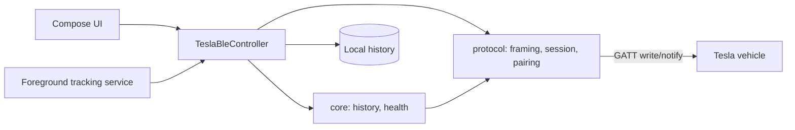

# Documentation layout

Where things go, so agents and humans file docs in the right place.

- [`master-plan.md`](master-plan.md) — phases, locked decisions, and open work.
- [`requirements/`](requirements/) — **product and UX requirements**: behavior,
  flows, open questions, and resolved decisions. Living documents; edit them
  freely. Requirements say *what the product should do and why*.
- [`adr/`](adr/) — **architecture decision records**: one numbered, immutable
  decision per file (context → decision → consequences). ADRs say *which
  technical approach we chose and why*, including trade-offs; supersede an ADR
  with a new one instead of rewriting it. Requirements link to the ADRs that
  implement them, and ADRs link back to the requirement.
- [`protocol/`](protocol/) — wire protocol notes: transport, session/pairing,
  domains.
- [`reference/fleet-telemetry-vs-ble.md`](reference/fleet-telemetry-vs-ble.md) —
  generated cloud-vs-BLE signal matrix (what Tesla data is readable over BLE);
  refreshed weekly by the signal-matrix workflow.
- [`research/`](research/) — competitive and exploratory research. The only
  place competitor names appear.
- Screenshots live in [`website/images/`](../website/images/) — one set shared by
  the README and the landing page.
- [`features.md`](features.md) — what the app does, in detail. Install and update steps are in [`faq.md`](faq.md).
- [`compatibility.md`](compatibility.md), [`faq.md`](faq.md), and
  [`release-checklist.md`](release-checklist.md) — supporting docs.

## Code layout

| Module | Purpose |
| --- | --- |
| `protocol/` | Pure-JVM Kotlin Tesla BLE protocol: BLE framing, session handshake, pairing, VCSEC/Infotainment messages (Tesla protos via Wire). No Android dependencies and nothing app-specific, so it can become a standalone library. |
| `core/` | Battery domain on top of `protocol`: history, charge and discharge projections, health estimates, the app's own log records. No Android dependencies. |
| `app/` | Android UI (Compose), BLE integration (`BluetoothGatt`), foreground tracking service, history storage. |
| `tools/go-fixtures` | Deterministic fixtures generated against the Go reference implementation and diffed in CI. |

Protocol details: [`protocol/`](protocol/). Architecture decisions:
[`adr/`](adr/). Data availability:
[`reference/fleet-telemetry-vs-ble.md`](reference/fleet-telemetry-vs-ble.md)
— a live cloud-vs-BLE signal matrix of what can be read over BLE.
