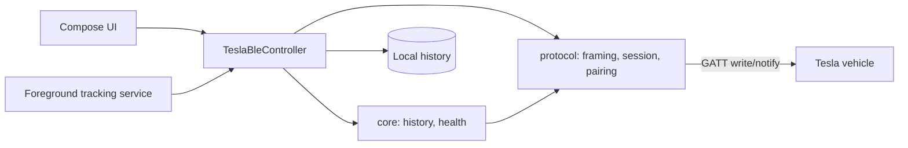

# Architecture overview

| Module | Purpose |
| --- | --- |
| `protocol/` | Pure-JVM Kotlin Tesla BLE protocol: BLE framing, session handshake, pairing, VCSEC/Infotainment messages (Tesla protos via Wire). No Android dependencies and nothing app-specific, so it can become a standalone library. |
| `core/` | Battery domain on top of `protocol`: history, charge and discharge projections, health estimates, the app's own log records. No Android dependencies. |
| `app/` | Android UI (Compose), BLE integration (`BluetoothGatt`), foreground tracking service, history storage. |
| `tools/go-fixtures` | Deterministic fixtures generated against the Go reference implementation and diffed in CI. |

Protocol details: [`protocol/`](protocol/). Architecture decisions:
[`adr/`](adr/). Data availability:
[`reference/fleet-telemetry-vs-ble.md`](reference/fleet-telemetry-vs-ble.md)
— a live cloud-vs-BLE signal matrix of what can be read over BLE.
